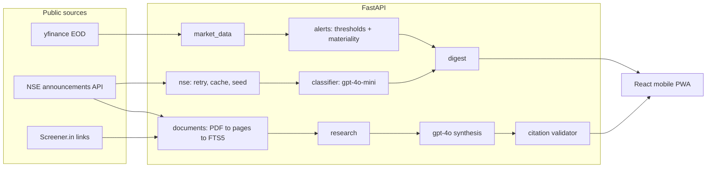

# FINN — a daily investor's filter

Mobile-first financial agent with two modes:

- **Push** — what changed across an 18-stock NSE portfolio, ranked by materiality, with configurable alerts.
- **Pull** — on-demand research on any NSE ticker, grounded only in annual reports, concall transcripts and exchange-filed results, with page-level citations.

The point of view: an investor does not need more information, they need triage. Today is a ranked feed with the routine filings collapsed; Alerts fire on thresholds the investor sets; Research never says anything it cannot cite.

## Run locally

```bash
# backend
cd backend
python3 -m venv .venv && .venv/bin/pip install -r requirements.txt
cp ../.env.example ../.env      # add OPENAI_API_KEY
.venv/bin/uvicorn app.main:app --port 8000

# frontend (separate terminal, proxies /api to :8000)
cd frontend && npm install && npm run dev      # http://localhost:5173

# quick smoke check against a running API
cd backend && .venv/bin/python smoke_check.py http://localhost:8000
```

## Architecture



### Data pipeline and fallbacks
| Source | Method | Fallback order |
|---|---|---|
| EOD price/volume | `yfinance` (`SYMBOL.NS`), 20-day volume baseline excludes the latest session | live → cache (6h) → committed seed |
| NSE announcements | session-bootstrapped `requests`, 1 req/s, jittered retries, cookie refresh | live → cache (5 min) → stale cache → committed seed (always badged "Snapshot") |
| Annual reports, concalls | Screener.in used **only as a link directory** (raw transcripts and reports, never its tables or AI summaries); PDFs parsed locally with `pypdf` into page-indexed text, chunked, indexed in SQLite FTS5 | cache → committed seed |

### Model routing and cost
- **Tier 0 (no model):** ticker validation, thresholds, QoQ/YoY, guidance-vs-delivery arithmetic, period matching, citation resolution.
- **Tier 1 `gpt-4o-mini`:** 17-way announcement classification (batched, cached per filing), results-number extraction, management-change extraction, bio drafting, guidance extraction from transcripts, annual-report series extraction.
- **Tier 2 `gpt-4o`:** one synthesis call per deep run over a bounded evidence packet (about a dozen excerpts plus computed facts), and the "Ask this company" box.
- Every result is cached by model, prompt version, schema and input hash; seeded results ship in `data/seed/llm`. Daily call budgets are enforced server-side.

### Grounding rules (Pull)
Only annual reports, company-issued transcripts and exchange-filed results enter the evidence packet. Every generated claim must cite a fact id or an excerpt with a verbatim quote; the validator re-finds that quote in the source text, resolves its real page, and drops any claim it cannot verify. Guidance quotes are verified against transcript pages the same way. Numbers (growth, margins, CAGR, cash conversion, FCF, D/E, promised-vs-delivered status) are computed in Python, never by the model.

### Narrative vs. numbers
For the four most recent concalls, the cheap model extracts management's forward statements (numeric guidance and growth commentary). Python normalises periods on the Indian fiscal calendar, matches each target to delivered results (quarterly filings, or the annual report for fiscal-year targets), and labels it `met`, `missed`, `partially met` or `not yet measurable`. The deep model only interprets that scorecard.

## Demo universe
- **Portfolio (18):** RELIANCE, HDFCBANK, TCS, BHARTIARTL, SUNPHARMA, LT, MARUTI, ITC, DIXON, POLYCAB, CDSL, DEEPAKNTR, CHALET, KPRMILL, CERA, BECTORFOOD, CMSINFO, SJS.
- **Ad-hoc research (4, outside the portfolio):** DMART, MAZDOCK, KPITTECH, RAINBOW. The engine works for any NSE ticker with documents on Screener (tested with ASIANPAINT).

## Deploy (one public link)
The API also serves the built frontend, so a single service is enough.
1. Push this repo to GitHub.
2. Render: *New → Blueprint* → pick the repo (uses `render.yaml` + `Dockerfile`). Set `OPENAI_API_KEY`.
3. Optional split deploy: frontend on Vercel (`frontend/vercel.json`, set `VITE_API_URL` to the Render URL, set `FRONTEND_ORIGIN` on the backend).
4. Optional cron: `POST /api/v1/refresh` with header `X-Refresh-Secret` after market close and every few minutes for announcements.
5. Check: `python backend/smoke_check.py https://<your-url>`.

NSE sometimes blocks cloud IPs; the app then serves the committed snapshot with a visible "Snapshot" badge instead of failing.

## Environment
| Variable | Purpose |
|---|---|
| `OPENAI_API_KEY` | Tier 1 and Tier 2 models (backend only) |
| `OPENAI_FAST_MODEL` / `OPENAI_REASONING_MODEL` | default `gpt-4o-mini` / `gpt-4o` |
| `REFRESH_SECRET` | protects `POST /api/v1/refresh` |
| `FRONTEND_ORIGIN` | CORS origin(s), default `*` |
| `MAX_CHEAP_CALLS` / `MAX_DEEP_CALLS` | daily safety budgets |

## Deliberately left out
Broker/news data, price targets or advice, trading, portfolio accounting, auth and multi-tenancy, a hosted vector DB, native push delivery (alerts live in an in-app inbox; the browser Notification API is a progressive enhancement), and test suites (a single `smoke_check.py` instead).

## Known limits
- Screener only lists annual-call transcripts for some companies (DMART) and has stale transcripts for others (MAZDOCK); the scorecard says so rather than inventing quarters.
- Results extraction reads whatever table the filing contains; units and consolidated/standalone basis are shown on every card. EBITDA is shown only when the filing reports it or all components exist.
- Executive bios use public search snippets (LinkedIn when indexed); they fall back to the filing's own background and say so.
